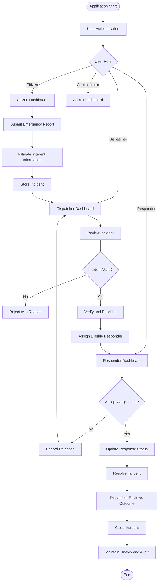
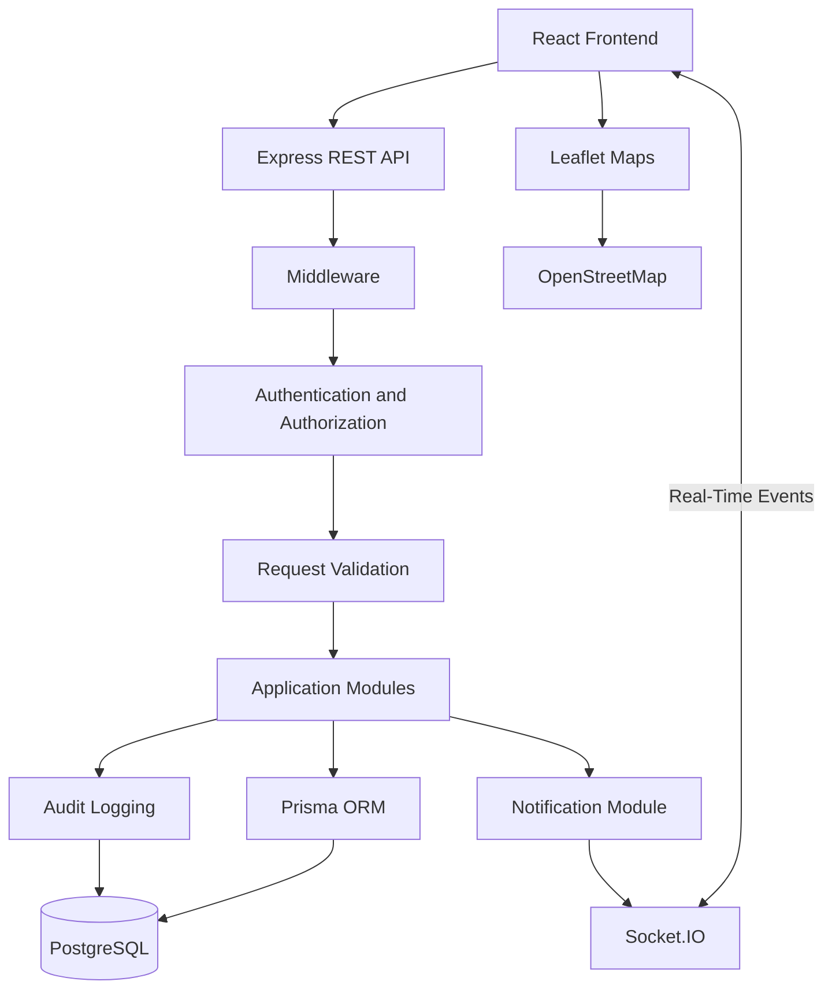

# SafeSignal
### Emergency Reporting & Response Coordination Platform

**Report Emergencies. Coordinate Responders. Track Response Progress.**

SafeSignal is a full-stack emergency reporting and response coordination platform designed to organize emergency reporting, incident verification, responder assignment, and response monitoring through a centralized digital system.

The platform connects four primary user roles: Citizens, Dispatchers, Responders, and Administrators. It provides structured workflows for submitting emergency reports, capturing incident locations, verifying incidents, prioritizing emergencies, assigning responders, tracking response progress, and maintaining incident history.

Built with a modern full-stack technology stack, SafeSignal combines secure authentication, role-based access control, REST APIs, real-time communication, location-based services, and structured data management to improve the organization, visibility, and accountability of emergency response coordination.

> **Important:** SafeSignal is an academic and development-oriented emergency coordination platform. It is not a replacement for official emergency numbers, ambulance services, police, fire services, or other emergency agencies. It does not guarantee responder availability or response times. Real-world emergency agency integration requires separate authorization, agreements, infrastructure, and technical implementation.

---

## Table of Contents

- [1. Project Overview](#1-project-overview)
- [2. Problem Statement](#2-problem-statement)
- [3. Project Vision and Objectives](#3-project-vision-and-objectives)
- [4. Proposed Solution](#4-proposed-solution)
- [5. Core Features](#5-core-features)
- [6. User Roles and Responsibilities](#6-user-roles-and-responsibilities)
- [7. Application Workflow](#7-application-workflow)
- [8. Incident Lifecycle](#8-incident-lifecycle)
- [9. Assignment Lifecycle](#9-assignment-lifecycle)
- [10. Technology Stack](#10-technology-stack)
- [11. System Architecture](#11-system-architecture)
- [12. Security and Privacy](#12-security-and-privacy)
- [13. Database and Data Management](#13-database-and-data-management)
- [14. Project Structure](#14-project-structure)
- [15. Getting Started](#15-getting-started)
- [16. Environment Configuration](#16-environment-configuration)
- [17. Database Setup](#17-database-setup)
- [18. Running the Application](#18-running-the-application)
- [19. Docker Setup](#19-docker-setup)
- [20. Testing and Quality Assurance](#20-testing-and-quality-assurance)
- [21. Documentation](#21-documentation)
- [22. Development Roadmap](#22-development-roadmap)
- [23. Project Scope and Limitations](#23-project-scope-and-limitations)
- [24. Contribution Guidelines](#24-contribution-guidelines)
- [25. License](#25-license)
- [26. Acknowledgements](#26-acknowledgements)

---

## 1. Project Overview

Emergency situations require timely communication, accurate information, and coordinated response activities.

Traditional emergency reporting and coordination processes can involve fragmented communication, incomplete incident information, delayed updates, and limited visibility into responder assignments and response progress.

SafeSignal addresses these workflow challenges through a centralized web application that organizes emergency reporting, incident verification, responder coordination, and response monitoring.

Citizens can submit emergency reports and provide incident location information. Dispatchers can review, verify, prioritize, and assign incidents. Responders can manage their availability, receive assignments, and update their response progress. Administrators can manage authorized platform users and operational configurations.

The platform maintains structured incident records, assignment history, notifications, and audit information to support operational visibility and accountability.

### Project Information

| Attribute | Description |
|---|---|
| Project Name | SafeSignal |
| Project Category | Emergency Management and Coordination |
| Application Type | Full-Stack Web Application |
| Primary Purpose | Emergency Reporting and Response Coordination |
| Architecture | Modular Monolith |
| Frontend | React, TypeScript, Vite |
| Backend | Node.js, Express.js, TypeScript |
| Database | PostgreSQL |
| ORM | Prisma |
| Authentication | Session-Based Authentication |
| Password Hashing | Argon2id |
| Real-Time Communication | Socket.IO |
| Validation | Zod |
| Maps | Leaflet and OpenStreetMap |
| Containerization | Docker Compose |
| Repository | [SafeSignal on GitHub](https://github.com/pawan-chaudhary-70056/SafeSignal-Emergency-Response-Platform) |

### Project Vision

To provide a centralized digital platform that organizes emergency reporting, strengthens coordination between authorized dispatchers and responders, and improves visibility into incident response activities.

---

## 2. Problem Statement

Emergency response coordination involves multiple participants, including citizens, dispatchers, and emergency responders.

Without a structured digital workflow, emergency information can become fragmented, assignments can be difficult to monitor, and incident progress may not be clearly communicated.

Common challenges include:

- Difficulty organizing emergency reports.
- Incomplete or inconsistent incident information.
- Limited visibility into incident verification.
- Challenges in managing responder assignments.
- Difficulty monitoring responder availability.
- Delayed communication between operational participants.
- Limited visibility into response progress.
- Difficulty maintaining incident history and accountability.
- Lack of centralized operational information.

SafeSignal aims to address these challenges by organizing emergency reports, dispatch decisions, responder assignments, and response updates within a centralized platform.

---

## 3. Project Vision and Objectives

### Project Vision

The long-term vision of SafeSignal is to establish a structured emergency coordination environment where citizens, dispatchers, responders, and administrators can interact through clearly defined workflows and authorized access.

### Project Objectives

1. Provide a user-friendly emergency reporting interface.
2. Enable citizens to submit emergency incidents.
3. Capture geographical location information.
4. Support manual location entry when geolocation is unavailable.
5. Allow dispatchers to review and verify incidents.
6. Support emergency prioritization.
7. Enable authorized responder assignment and reassignment.
8. Track responder availability and response progress.
9. Provide real-time communication where connectivity is available.
10. Maintain incident and assignment history.
11. Implement secure authentication and role-based access control.
12. Protect sensitive incident, contact, and location information.
13. Maintain operational records and audit information.
14. Establish a foundation for future emergency coordination capabilities.

---

## 4. Proposed Solution

SafeSignal introduces a centralized, role-based emergency coordination platform.

The application organizes emergency activities through a structured workflow:

1. A citizen registers or logs into the application.
2. The citizen submits an emergency report.
3. The application validates the submitted information.
4. Incident information is stored in PostgreSQL.
5. An authorized dispatcher reviews the incident.
6. The dispatcher verifies or rejects the incident.
7. Verified incidents receive an appropriate priority.
8. An eligible responder is selected and assigned.
9. The responder accepts or rejects the assignment.
10. The responder updates the response status.
11. The dispatcher monitors response progress.
12. The incident is marked resolved.
13. The dispatcher reviews the outcome and closes the incident.
14. Relevant incident, assignment, and audit history is maintained.

The platform uses REST APIs for its primary application operations and Socket.IO for real-time communication and event delivery.

---

## 5. Core Features

### 5.1 Citizen Module

Citizens can:

- Register and authenticate.
- Manage personal profiles.
- Select emergency categories.
- Submit SOS and emergency incident reports.
- Provide incident descriptions and contact information.
- Capture their location through browser geolocation.
- Enter locations manually when geolocation is unavailable.
- View incident reference information.
- Monitor submitted incident status.
- View personal incident history.
- Cancel eligible incidents.
- Upload supporting evidence.
- Download permitted supporting evidence.
- Receive in-app notifications.

### 5.2 Dispatcher Module

Dispatchers can:

- Access the dispatcher dashboard.
- View submitted emergency incidents.
- Review incident details.
- Verify or reject incidents.
- Record rejection reasons.
- Prioritize emergency incidents.
- Review responder availability.
- Assign eligible responders.
- Reassign responders when required.
- Monitor assignment progress.
- View incident status updates.
- Maintain dispatch notes.
- Review operational history.
- Access permitted supporting evidence.

### 5.3 Responder Module

Responders can:

- Access their responder dashboard.
- Manage responder profiles.
- Update availability.
- View assigned incidents.
- Accept or reject assignments.
- Update response progress.
- Report en-route status.
- Report arrival.
- Update in-progress status.
- Mark incidents as resolved.
- Review assignment history.

### 5.4 Administrator Module

Administrators can:

- Create authorized user accounts.
- Correct user profile information.
- Manage user roles.
- Manage account status.
- Manage emergency categories.
- Review operational information.
- Access authorized audit information.
- Perform administrative activities.

### 5.5 Platform Capabilities

- Role-based access control.
- Session-based authentication.
- REST API architecture.
- Real-time Socket.IO communication.
- In-app notifications.
- Incident and assignment lifecycle management.
- Protected evidence storage.
- Interactive location maps.
- Leaflet and OpenStreetMap integration.
- Request validation using Zod.
- Database transaction handling for critical operations.
- Responsive user interface.
- Docker-based development environment.

---

## 6. User Roles and Responsibilities

SafeSignal separates responsibilities through role-based access control.

| User Role | Primary Responsibilities |
|---|---|
| Citizen | Submit emergency reports and monitor personal incidents |
| Dispatcher | Review, verify, prioritize, assign, and monitor incidents |
| Responder | Manage availability and respond to assigned incidents |
| Administrator | Manage authorized users, roles, categories, and platform operations |

### Access Control Principles

- Citizens can access their permitted personal incident information.
- Responders can access assigned incidents and permitted information.
- Dispatchers can access incidents within their authorized operational scope.
- Administrators can perform permitted administrative operations.
- Resource ownership and operational scope must be considered alongside user roles.

A user's role alone must not automatically grant unrestricted access to every incident or private record.

---

## 7. Application Workflow

### High-Level Emergency Workflow



### Workflow Principles

- Incident submission and verification are separate operations.
- Only authorized users can perform operational actions.
- Responder assignments follow a structured process.
- Assignment history is maintained independently.
- Critical database operations should preserve consistency.
- Users receive permitted updates through the notification system.
- Failed operations should not silently modify incident history.

---

## 8. Incident Lifecycle

SafeSignal maintains a structured incident lifecycle to support consistent status management.

```text
SUBMITTED
    |
    v
UNDER_REVIEW
    |
    v
VERIFIED
    |
    v
ASSIGNED
    |
    v
ACCEPTED
    |
    v
EN_ROUTE
    |
    v
ARRIVED
    |
    v
IN_PROGRESS
    |
    v
RESOLVED
    |
    v
CLOSED
```

Additional incident states:

- `REJECTED`
- `CANCELLED`

Only authorized users can perform permitted status transitions.

Incident status changes should be validated and recorded to maintain operational consistency.

---

## 9. Assignment Lifecycle

Incident records and responder assignment records are maintained separately.

```text
PENDING
   |
   +------> ACCEPTED ------> COMPLETED
   |
   +------> REJECTED
   |
   +------> REASSIGNED


ACCEPTED
   |
   +------> REASSIGNED
```

### Assignment Management Principles

- Responders must be eligible for assignment.
- Responders can accept or reject assignments.
- Rejected assignments should be recorded.
- Reassignment should preserve previous assignment records.
- Assignment history should not be silently overwritten.
- Assignment status and incident status must remain consistent.
- Concurrent assignment attempts require appropriate validation and transaction handling.

---

## 10. Technology Stack

SafeSignal uses a modern full-stack development environment.

| Layer | Technology | Purpose |
|---|---|---|
| Frontend | React | User interface |
| Language | TypeScript | Type safety |
| Build Tool | Vite | Frontend development and builds |
| Styling | Tailwind CSS | Responsive UI styling |
| Backend | Node.js | Server-side runtime |
| API Framework | Express.js | REST API development |
| Language | TypeScript | Backend type safety |
| Database | PostgreSQL | Persistent data storage |
| ORM | Prisma | Database access and migrations |
| Validation | Zod | Request and data validation |
| Password Security | Argon2id | Secure password hashing |
| Session Management | HttpOnly Cookies | Session-based authentication |
| Real-Time Communication | Socket.IO | Live event communication |
| Maps | Leaflet | Interactive map interface |
| Map Data | OpenStreetMap | Map tile provider |
| Containers | Docker Compose | Development environment |
| Version Control | Git | Source control |
| Repository Hosting | GitHub | Project hosting |

---

## 11. System Architecture

SafeSignal follows a **Modular Monolith Architecture** for its initial implementation.

The backend is organized into logical application modules while operating as one deployable application.

### High-Level Architecture



### Main Backend Modules

- Authentication and Authorization
- User Management
- Incident Management
- Emergency Categories
- Dispatch Management
- Responder Management
- Assignment Management
- Notification Management
- Evidence Management
- Audit Logging
- Analytics

### Architecture Principles

- Modular backend organization.
- Separation of frontend and backend responsibilities.
- PostgreSQL as the primary source of truth.
- Database transactions for critical operations.
- REST APIs for application operations and state retrieval.
- Socket.IO for real-time event delivery.
- Resource-level authorization.
- Separation of incident and assignment lifecycles.
- Centralized validation and error handling.
- Future flexibility for selective microservices extraction.

**Architecture clarification:** Microservices, Redis, Kafka, and Kubernetes are not mandatory components of the initial MVP. The initial architecture is a Modular Monolith, with the possibility of selective service extraction as the project evolves.

---

## 12. Security and Privacy

Security is a core consideration because SafeSignal handles sensitive information, including emergency descriptions, contact details, and location information.

### Security Controls

- Password hashing using Argon2id.
- Session-based authentication.
- HttpOnly session cookies.
- Session expiration and logout.
- Role-based access control.
- Resource-level authorization.
- Zod request validation.
- CSRF protection for cookie-authenticated state-changing requests.
- Restricted CORS configuration.
- Secure HTTP headers.
- Rate limiting.
- Safe database access through Prisma.
- Protected evidence storage.
- Audit logging for important actions.
- Environment-based secret management.
- Sanitized application error responses.

### Privacy Principles

- Citizens should access only their permitted personal incident information.
- Responders should access only assigned incidents and permitted fields.
- Dispatchers should operate within their authorized scope.
- Administrative privileges should not automatically expose every private incident detail.
- Sensitive location and contact information should be protected.
- Sensitive information should not be unnecessarily exposed through logs or notifications.
- User information should be handled according to the application's access and retention policies.

For additional information, refer to `docs/07-security/`.

---

## 13. Database and Data Management

SafeSignal uses PostgreSQL as its primary database and Prisma ORM for database operations.

The database supports the application's operational requirements, including:

- User account information.
- User roles and permissions.
- Emergency categories.
- Incident records.
- Incident status history.
- Responder availability.
- Responder assignments.
- Assignment history.
- Notifications.
- Supporting evidence metadata.
- Audit information.

### Data Management Principles

- Maintain structured relational data.
- Enforce appropriate database constraints.
- Validate information before persistence.
- Use transactions for critical operations.
- Preserve historical assignment information.
- Protect sensitive information.
- Avoid destructive database operations without authorization.
- Maintain consistency between incident and assignment records.

Refer to `docs/05-database-design/` for detailed database documentation.

---

## 14. Getting Started

### Prerequisites

Install the following tools before starting development:

| Requirement | Purpose |
|---|---|
| Node.js | Frontend and backend runtime |
| npm | Dependency management |
| PostgreSQL | Database |
| Git | Version control |
| Docker | Containerization |
| Docker Compose | Multi-container environment |
| Code Editor | Development environment |

Use versions compatible with the project's package configuration.

### Clone the Repository

```bash
git clone https://github.com/pawan-chaudhary-70056/SafeSignal-Emergency-Response-Platform.git

cd SafeSignal-Emergency-Response-Platform
```

### Install Frontend Dependencies

```bash
cd frontend
npm install
```

### Install Backend Dependencies

```bash
cd ../backend
npm install
```

Return to the project root:

```bash
cd ..
```

---

## 15. Environment Configuration

Configure the environment variables required by the backend and frontend.

Use the project's environment example files and validation schemas to identify the exact required variable names.

### Example Backend Configuration

```env
NODE_ENV=development
PORT=4000

DATABASE_URL=your_database_connection_string

SESSION_SECRET=your_strong_random_secret

FRONTEND_URL=http://localhost:5173
```

### Example Frontend Configuration

```env
VITE_API_BASE_URL=http://localhost:4000
```

These values are examples. Actual variable names must match the application's environment validation schema.

### Security Recommendations

- Never commit `.env` files containing real secrets.
- Keep `.env.example` free of actual credentials.
- Use strong randomly generated session secrets.
- Keep development and production credentials separate.
- Use secure cookie settings in production.
- Do not expose database credentials.
- Rotate compromised credentials immediately.

---

## 16. Database Setup

SafeSignal uses PostgreSQL with Prisma ORM.

After configuring the database connection, navigate to the backend directory:

```bash
cd backend
```

### Generate Prisma Client

```bash
npx prisma generate
```

### Check Migration Status

```bash
npx prisma migrate status
```

### Apply Existing Migrations in Development

```bash
npx prisma migrate dev
```

### Apply Migrations in Production

```bash
npx prisma migrate deploy
```

Return to the project root:

```bash
cd ..
```

**Important:** Never use destructive database reset commands on databases containing important information without a verified backup.

---

## 17. Running the Application

### Start the Backend

Open a terminal:

```bash
cd backend
npm run dev
```

### Start the Frontend

Open another terminal:

```bash
cd frontend
npm run dev
```

### Local Development Addresses

| Service | Address |
|---|---|
| Frontend | `http://localhost:5173` |
| Backend | `http://localhost:4000` |
| PostgreSQL | Configured database host and port |

Actual ports and scripts must match the application configuration.

---

## 18. Docker Setup

SafeSignal supports a Docker Compose-based development environment.

### Build and Start Services

```bash
docker compose up --build
```

### Check Running Containers

```bash
docker compose ps
```

### View Application Logs

```bash
docker compose logs
```

### Stop Services

```bash
docker compose down
```

**Data Safety:** Avoid `docker compose down -v` unless volume deletion is explicitly intended and all required data has been safely backed up.

For detailed deployment instructions, refer to `docs/09-deployment/`.

---

## 19. Testing and Quality Assurance

Testing is important for maintaining application reliability, security, and data consistency.

SafeSignal includes documented backend integration testing, frontend end-to-end testing, performance validation, and static quality checks.

### Testing Areas

- User registration and authentication.
- Session creation and expiration.
- Role-based authorization.
- Citizen emergency reporting.
- Incident validation.
- Dispatcher verification and rejection.
- Incident prioritization.
- Responder assignment.
- Assignment acceptance and rejection.
- Responder reassignment.
- Response status updates.
- Incident resolution and closure.
- Notification creation and delivery.
- Socket.IO authentication and reconnection.
- Location capture and manual fallback.
- Evidence attachment.
- Database transaction integrity.
- Security and input validation.
- Accessibility and responsive navigation.

### Backend Integration Tests

The documented backend integration suite contains 26 tests and uses an isolated test database.

```bash
cd backend
npm test
```

### Backend Test Coverage

```bash
cd backend
npm run test:coverage
```

The coverage command uses Node.js test instrumentation and reports per-file coverage.

### API Performance Validation

```bash
cd backend
npm run perf:latency
```

The documented performance validation measures p50/p95 response latency for configured read endpoints against a 500 ms p95 target.

See `docs/08-testing/performance-and-latency-validation.md` for the measurement methodology.

### Frontend End-to-End Tests

Start the backend and frontend, then run:

```bash
cd frontend
npx playwright test
```

The documented Playwright suite contains 16 checks covering:

- Emergency reporting and response workflow.
- Citizen cancellation.
- Responder reassignment history.
- Evidence attachment.
- Profile management.
- Administrative user creation and profile correction.
- Socket reconnection recovery.
- Location capture and map selection.
- Accessibility.
- Mobile navigation.

### Demo Data Management

For authorized local development testing:

```bash
cd backend
npm run db:seed:demo
```

To reset the demo environment:

```bash
npm run db:reset:demo
```

**Warning:** Demo reset operations may delete demo incidents and evidence and restore demo identities. Never run them against a production database.

### Static Quality Checks

Run these commands in the respective backend or frontend directory:

```bash
npm run typecheck
npm run lint
npm run format:check
```

Apply formatting:

```bash
npm run format
```

Apply automatically fixable lint rules:

```bash
npm run lint:fix
```

---

## 20. Development Roadmap

The following roadmap describes the development direction of SafeSignal. Roadmap items should not be interpreted as completed features unless they have been implemented and verified.

### Phase 1 – Core Application

- Project configuration.
- Database and Prisma setup.
- User authentication.
- Role-based access control.
- Citizen emergency reporting.
- Incident management.
- Dispatcher verification and prioritization.
- Responder management.
- Assignment and response tracking.

### Phase 2 – Coordination Improvements

- Real-time Socket.IO updates.
- In-app notifications.
- Incident and assignment history.
- Audit logging.
- Location and map integration.
- Administrative management.
- Evidence management improvements.

### Phase 3 – Reliability and Security

- Expanded automated testing.
- Improved concurrency handling.
- Better error handling.
- Backup and recovery procedures.
- Security validation.
- Deployment improvements.
- Monitoring and operational visibility.

### Phase 4 – Future Enhancements

- SMS and email notification integrations.
- Advanced geospatial capabilities.
- Analytics and reporting.
- Authorized emergency agency integrations.
- Additional responder coordination capabilities.
- Advanced monitoring and observability.
- Scalable infrastructure.
- Selective microservices extraction.

---

## 21. Project Scope and Limitations

SafeSignal focuses on emergency reporting and response coordination workflows.

### Current Project Scope

- Citizen incident reporting.
- Dispatcher incident management.
- Incident verification and prioritization.
- Responder assignment and reassignment.
- Response progress tracking.
- Real-time communication.
- In-app notifications.
- Location-based incident information.
- Basic administration.
- Secure data handling.
- Incident and assignment history.

### Limitations

The initial version does not claim:

- Direct integration with official emergency dispatch systems.
- Guaranteed ambulance, police, or rescue availability.
- Guaranteed emergency response times.
- Fully automated emergency dispatch.
- Continuous availability of external map services.
- Production-grade high availability without additional infrastructure and validation.

Real-world operational use requires appropriate legal, security, operational, infrastructure, and emergency-service approvals.

---

## 22. Contribution Guidelines

Contributions are welcome when they improve the reliability, usability, security, functionality, or maintainability of SafeSignal.

### Contribution Process

1. Fork the repository or create an authorized development branch.
2. Create a focused feature or bug-fix branch.
3. Follow existing coding conventions.
4. Validate inputs and handle errors safely.
5. Add or update relevant tests.
6. Update documentation when application behavior changes.
7. Review security implications.
8. Submit a pull request with a clear explanation.

### Development Principles

- Maintain readable and maintainable code.
- Follow established architecture.
- Avoid exposing sensitive information.
- Preserve authentication and authorization controls.
- Test critical application workflows.
- Maintain database consistency.
- Keep documentation aligned with implementation.

---

## 23. License

No formal license has been specified in the current project documentation.

A suitable open-source or proprietary license should be selected by the project owner before public distribution.

Until a license is added, do not assume that the source code is available for unrestricted reuse, modification, or redistribution.

---

## 24. Acknowledgements

SafeSignal is developed using open-source technologies and tools, including:

- React
- TypeScript
- Vite
- Tailwind CSS
- Node.js
- Express.js
- PostgreSQL
- Prisma
- Zod
- Argon2
- Socket.IO
- Leaflet
- OpenStreetMap
- Docker
- Git
- GitHub

Their respective licenses, documentation, and usage policies should be respected.

---

## Project Repository

**GitHub Repository:**  
https://github.com/pawan-chaudhary-70056/SafeSignal-Emergency-Response-Platform

**SafeSignal – Emergency Reporting & Response Coordination Platform**

*Built to organize emergency reporting, improve response coordination, and maintain accountable incident workflows.*
