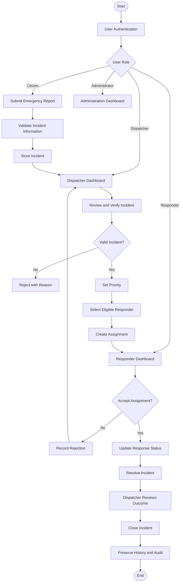
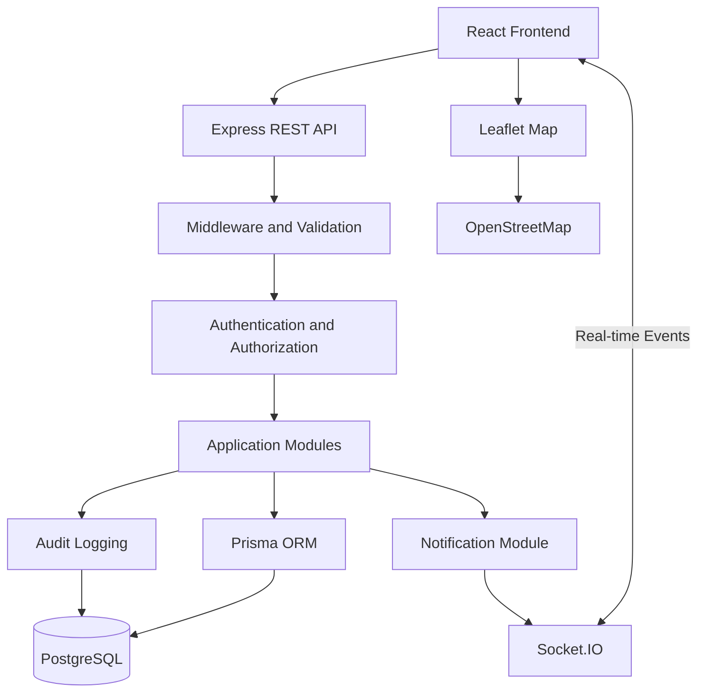

# SafeSignal

### Emergency Reporting & Response Coordination Platform

**Report emergencies. Coordinate responders. Track response progress.**

SafeSignal is a web-based emergency reporting and response coordination platform designed to help citizens report emergency situations and enable authorized dispatchers to coordinate responder assignments and monitor response progress.

The platform provides a centralized workflow for emergency reporting, incident verification, responder assignment, real-time status updates, notifications, and incident history.

SafeSignal is designed for controlled demonstrations, academic projects, and future development into a more comprehensive emergency coordination solution.

> **Important:** SafeSignal is not a replacement for official emergency numbers or emergency services. It does not guarantee responder availability or response times. Real-world emergency agency integration requires separate authorization, agreements, and technical implementation.

---

## Table of Contents

- [Project Overview](#project-overview)
- [Problem Statement](#problem-statement)
- [Proposed Solution](#proposed-solution)
- [Key Features](#key-features)
- [User Roles](#user-roles)
- [How SafeSignal Works](#how-safesignal-works)
- [Incident Lifecycle](#incident-lifecycle)
- [Assignment Lifecycle](#assignment-lifecycle)
- [Technology Stack](#technology-stack)
- [System Architecture](#system-architecture)
- [Security and Privacy](#security-and-privacy)
- [Project Structure](#project-structure)
- [Getting Started](#getting-started)
- [Environment Configuration](#environment-configuration)
- [Database Setup](#database-setup)
- [Running the Application](#running-the-application)
- [Testing](#testing)
- [Docker Setup](#docker-setup)
- [Documentation](#documentation)
- [Development Roadmap](#development-roadmap)
- [Project Scope and Limitations](#project-scope-and-limitations)
- [Contributing](#contributing)
- [License](#license)
- [Acknowledgements](#acknowledgements)

---

## Project Overview

Emergency situations require timely communication, accurate information, and coordinated response activities.

SafeSignal aims to organize these activities through a centralized web application where citizens can submit emergency reports, dispatchers can review and manage incidents, and responders can receive assignments and update their response progress.

The system maintains incident records, assignment history, notifications, and audit information to improve operational visibility and accountability.

### Project Objectives

- Provide a simple emergency reporting interface.
- Allow citizens to submit incident details and location information.
- Help dispatchers review, verify, prioritize, and manage incidents.
- Support responder assignment and reassignment.
- Track responder progress through defined status updates.
- Provide real-time notifications where connectivity is available.
- Maintain incident and assignment history.
- Apply role-based access control and data protection.
- Establish a foundation for future emergency coordination capabilities.

## Problem Statement

Emergency reporting and response coordination can involve fragmented communication, incomplete information, delayed updates, and limited visibility into response progress.

Without a centralized workflow:

- Incident information may be difficult to organize.
- Dispatchers may struggle to track multiple reports.
- Responder availability and assignment status may be unclear.
- Citizens may have limited visibility into submitted reports.
- Incident history and accountability may be difficult to maintain.

SafeSignal addresses these workflow challenges by organizing emergency reports, dispatch decisions, responder assignments, and status updates within one platform.

## Proposed Solution

SafeSignal introduces a role-based emergency coordination workflow.

1. Citizens submit emergency reports.
2. The system validates and stores incident information.
3. Dispatchers review and verify submitted incidents.
4. Authorized dispatchers assign eligible responders.
5. Responders accept or reject assignments.
6. Responders update their response progress.
7. Dispatchers review the outcome and close incidents.
8. The system preserves relevant history and audit records.

The platform uses PostgreSQL as its primary data source and Socket.IO for real-time communication. REST APIs provide the main interface for application operations and state retrieval.

## Key Features

### Citizen Features

- User registration and login.
- Citizen profile management.
- Emergency category selection.
- SOS and emergency incident reporting.
- Incident description and contact information.
- Browser-based location detection.
- Manual location entry when geolocation is unavailable.
- Incident reference and status visibility.
- Personal incident history.
- Supporting evidence attachment and download.
- Profile management with protected account fields.
- In-app notifications.

### Dispatcher Features

- Dispatcher dashboard.
- Incident listing and detail views.
- Incident verification and rejection.
- Incident prioritization.
- Responder availability overview.
- Responder assignment and reassignment.
- Assignment monitoring.
- Incident status monitoring.
- Dispatch notes and operational history.
- Supporting evidence attachment and download.

### Responder Features

- Responder account and profile.
- Availability management.
- Assigned incident visibility.
- Assignment acceptance and rejection.
- Response status updates.
- En-route and arrival updates.
- In-progress and resolution updates.
- Assignment history.

### Administrator Features

- User creation and profile correction.
- Role management.
- Emergency category management.
- Account status management.
- Basic platform administration.
- Audit and operational oversight.

### Platform Features

- Role-based access control.
- Secure authentication.
- Incident and assignment lifecycle management.
- Real-time communication using Socket.IO.
- In-app notifications.
- Private evidence storage with content validation.
- Location display using Leaflet.
- OpenStreetMap-based map tiles.
- Input validation using Zod.
- Database transaction handling for critical operations.
- Responsive user interface.
- Docker-based development environment.

---

## User Roles

SafeSignal uses role-based access control to separate user responsibilities.

| Role | Main Responsibilities |
|---|---|
| Citizen | Submit emergency reports and monitor personal incidents |
| Dispatcher | Review, verify, prioritize, assign, and monitor incidents |
| Responder | Manage availability and respond to assigned incidents |
| Administrator | Manage authorized platform users, roles, and categories |

Access to incident information must also consider resource ownership and operational scope, not only the user's role.

## How SafeSignal Works



## Incident Lifecycle

SafeSignal uses a defined incident lifecycle to maintain consistent status transitions.

```text
SUBMITTED
    |
    v
UNDER_REVIEW
    |
    v
VERIFIED
    |
    v
ASSIGNED
    |
    v
ACCEPTED
    |
    v
EN_ROUTE
    |
    v
ARRIVED
    |
    v
IN_PROGRESS
    |
    v
RESOLVED
    |
    v
CLOSED
```

Additional states:

- `REJECTED`
- `CANCELLED`

Only authorized users can perform permitted transitions.

## Assignment Lifecycle

Incident and Assignment records are maintained separately.

```text
PENDING
   |
   +------> ACCEPTED ------> COMPLETED
   |
   +------> REJECTED
   |
   +------> REASSIGNED

ACCEPTED
   |
   +------> REASSIGNED
```

Previous assignments must remain available in assignment history. Reassignment must not silently overwrite historical records.

---

## Technology Stack

| Layer | Technology | Purpose |
|---|---|---|
| Frontend | React | User interface |
| Language | TypeScript | Type safety |
| Build Tool | Vite | Frontend development and build |
| Styling | Tailwind CSS | Responsive UI styling |
| Backend | Node.js | Server-side runtime |
| API Framework | Express.js | REST API development |
| Language | TypeScript | Backend type safety |
| Database | PostgreSQL | Persistent data storage |
| ORM | Prisma | Database access and migrations |
| Validation | Zod | Request and data validation |
| Authentication | Argon2id | Password hashing |
| Sessions | HttpOnly Cookies | Session-based authentication |
| Real-time | Socket.IO | Live event communication |
| Maps | Leaflet | Interactive map interface |
| Map Data | OpenStreetMap | Map tile provider |
| Containers | Docker Compose | Development environment |
| Version Control | Git and GitHub | Source code management |

## System Architecture

SafeSignal follows a **Modular Monolith Architecture** for its initial implementation.

The backend is organized into independent logical modules while running as one deployable application.

### Main Modules

- Authentication and Authorization
- User Management
- Incident Management
- Emergency Categories
- Dispatch Management
- Responder Management
- Assignment Management
- Notification Management
- Evidence Management
- Audit Logging
- Analytics

### High-Level Architecture



### Architecture Principles

- Modular backend organization.
- Clear separation of frontend and backend responsibilities.
- PostgreSQL as the source of truth.
- Database transactions for critical operations.
- REST APIs for reliable state retrieval.
- Socket.IO for real-time event delivery.
- Authentication and authorization at appropriate application boundaries.
- Separation of incident and assignment lifecycles.
- Future flexibility for selective microservices extraction.

Microservices, Redis, Kafka, and Kubernetes are not mandatory components of the initial MVP.

---

## Security and Privacy

SafeSignal handles sensitive information, including emergency descriptions, contact details, and location information.

Security is therefore a core design consideration.

### Security Controls

- Password hashing using Argon2id.
- HttpOnly session cookies.
- Session expiration and logout.
- Role-based access control.
- Resource-level authorization.
- Zod request validation.
- CSRF protection for cookie-authenticated state-changing requests.
- Restricted CORS configuration.
- Secure HTTP headers.
- Rate limiting.
- Safe database access through Prisma.
- Protected evidence storage.
- Audit logging for important actions.
- Secret management through environment configuration.
- Sanitized application error responses.

### Privacy Principles

- Citizens should access only their permitted personal incident information.
- Responders should access only assigned incidents and permitted fields.
- Dispatchers should access incidents within their authorized operational scope.
- Administrative privileges should not automatically expose every private incident detail.
- Location and contact information should be protected.
- Sensitive data should not be exposed through logs or notifications unnecessarily.

---

## Project Structure

The following is the intended high-level application structure. Exact implementation directories may evolve during development.

```text
SafeSignal/
│
├── docs/
│
├── frontend/
│   ├── src/
│   │   ├── components/
│   │   ├── pages/
│   │   ├── layouts/
│   │   ├── hooks/
│   │   ├── services/
│   │   ├── contexts/
│   │   ├── routes/
│   │   ├── types/
│   │   └── utils/
│   │
│   └── package.json
│
├── backend/
│   ├── src/
│   │   ├── config/
│   │   ├── middleware/
│   │   ├── modules/
│   │   ├── routes/
│   │   ├── services/
│   │   ├── utils/
│   │   └── server.ts
│   │
│   ├── prisma/
│   │   └── schema.prisma
│   │
│   └── package.json
│
├── docker-compose.yml
├── .env.example
├── .gitignore
└── README.md
```

This is an illustrative target structure, not a claim that every directory or file has already been implemented.

---

## Getting Started

### Prerequisites

Install the following tools before starting development:

| Requirement | Purpose |
|---|---|
| Node.js | Frontend and backend runtime |
| npm | Dependency management |
| PostgreSQL | Database |
| Git | Version control |
| Docker | Containerization |
| Docker Compose | Multi-container environment |
| Code Editor | Development environment |

Use compatible versions of the tools defined by the project's package files and deployment configuration.

### Clone the Repository

```bash
git clone <REPOSITORY_URL>
cd SafeSignal
```

Replace `<REPOSITORY_URL>` with the actual repository URL.

### Install Dependencies

Frontend:

```bash
cd frontend
npm install
```

Backend:

```bash
cd ../backend
npm install
```

Return to the project root:

```bash
cd ..
```

---

## Environment Configuration

Create the required environment files based on the supplied example configuration.

Example backend environment:

```env
NODE_ENV=development
PORT=4000

DATABASE_URL=<DATABASE_CONNECTION_STRING>

SESSION_SECRET=<STRONG_RANDOM_SECRET>

FRONTEND_URL=<FRONTEND_ORIGIN>
```

Example frontend environment:

```env
VITE_API_BASE_URL=<BACKEND_API_URL>
```

Actual variable names must match the application's environment validation schema.

### Important

- Never commit `.env` files containing real secrets.
- Keep `.env.example` free of actual credentials.
- Use strong randomly generated session secrets.
- Use secure cookie settings in production.
- Keep production credentials separate from development credentials.

---

## Database Setup

SafeSignal uses PostgreSQL with Prisma ORM.

After configuring the database connection, navigate to the backend directory:

```bash
cd backend
```

Generate the Prisma Client:

```bash
npx prisma generate
```

Check migration status:

```bash
npx prisma migrate status
```

Apply existing migrations in a development environment:

```bash
npx prisma migrate dev
```

For an authorized production deployment:

```bash
npx prisma migrate deploy
```

Return to the project root when finished:

```bash
cd ..
```

Do not use destructive database reset commands on databases containing important information.

---

## Running the Application

### Start the Backend

```bash
cd backend
npm run dev
```

The development backend is expected to use the configured port, with `4000` as the documented example.

### Start the Frontend

Open another terminal:

```bash
cd frontend
npm run dev
```

The Vite development server commonly uses port `5173`.

Actual ports and scripts must match the project configuration.

### Application Access

Typical local development addresses:

| Service | Address |
|---|---|
| Frontend | `http://localhost:5173` |
| Backend | `http://localhost:4000` |
| PostgreSQL | Configured database host and port |

A health-check endpoint must be implemented before treating any example health-check URL as available.

---

## Testing

Testing should cover the critical application workflows and security controls.

### Testing Areas

- User registration and login.
- Session creation and expiration.
- Role-based authorization.
- Citizen incident submission.
- Incident validation.
- Dispatcher verification and rejection.
- Incident prioritization.
- Responder assignment.
- Assignment acceptance and rejection.
- Reassignment.
- Responder status updates.
- Incident resolution and closure.
- Notification creation and delivery.
- Socket.IO authentication and reconnection.
- Location permission and manual fallback.
- Database transaction integrity.
- Security and input validation.

### Testing Principles

- Test successful and failed operations.
- Test unauthorized access.
- Test invalid input.
- Test concurrent assignment attempts.
- Verify database state after critical operations.
- Test disconnected-client state reconciliation.
- Use simulated incidents and authorized test accounts.

Run the test scripts defined in the respective package files.

### Backend Integration Tests

```bash
cd backend
npm test
```

The suite (26 tests) runs against an isolated `*_test` database, so it never touches development data.

Line coverage uses Node's built-in test instrumentation, so no extra coverage dependency is required:

```bash
cd backend
npm run test:coverage
```

The command prints a per-file coverage table after the suite finishes.

API response-time validation (NFR-016): `npm run perf:latency` measures p50/p95 latency of the common read endpoints against a running API and exits non-zero if any endpoint misses the 500 ms p95 target. Results and method are recorded in `docs/08-testing/performance-and-latency-validation.md`.

### Playwright E2E Suite

Start the backend (`npm run dev` in `backend/`) and the frontend (`npm run dev` in `frontend/`), then:

```bash
cd frontend
npx playwright test
```

The 16-check suite covers the full emergency flow (report → review → verify → assign → accept → respond → resolve → close), citizen cancellation, reassignment history, evidence attachment with profile management, admin user creation and inline profile correction, socket reconnection recovery, location capture with the map picker, accessibility, and mobile (Pixel 5) navigation.

The suite is rerunnable: each run cleans up after itself, and two consecutive runs pass without touching the database. For further back-to-back reruns, reset the demo state first — it clears demo incidents and evidence, frees responders, restores demo identities, and clears rate-limit counters:

```bash
cd backend
npm run db:reset:demo
```

Demo accounts (password `Password123!`) are reseeded with `npm run db:seed:demo`.

### Static Quality Checks

Both applications use TypeScript strict mode, ESLint (flat config) and Prettier. Run the same checks in either `backend/` or `frontend/`:

```bash
npm run typecheck
npm run lint
npm run format:check
```

`npm run format` applies the Prettier configuration. `npm run lint:fix` applies the automatically fixable ESLint rules.

---

## Docker Setup

SafeSignal is designed to support a Docker Compose-based development environment.

Build and start the configured services:

```bash
docker compose up --build
```

View running containers:

```bash
docker compose ps
```

View logs:

```bash
docker compose logs
```

Stop services:

```bash
docker compose down
```

**Warning:** Avoid `docker compose down -v` unless volume deletion is explicitly intended and all required data has been safely backed up.

Refer to `docs/09-deployment/docker-and-database-setup.md` for detailed instructions.

---

## Documentation

The `docs/` directory contains the project's detailed technical and implementation documentation.

| Directory | Description |
|---|---|
| `01-project-overview/` | Project purpose, scope, objectives, and users |
| `02-software-requirements/` | Functional and non-functional requirements |
| `03-application-workflows/` | Authentication, reporting, dispatch, and response workflows |
| `04-system-architecture/` | Architecture, modules, data flow, and deployment design |
| `05-database-design/` | Database structure, relationships, and constraints |
| `06-api-documentation/` | API standards, endpoints, and real-time events |
| `07-security/` | Security architecture, authorization, and privacy |
| `08-testing/` | Testing strategy, test cases, and release checks |
| `09-deployment/` | Environment setup, Docker, deployment, and recovery |

Start with [`docs/README.md`](docs/README.md) for the documentation index.

---

## Development Roadmap

### Phase 1 – Core MVP

- Project setup.
- Database and Prisma configuration.
- User authentication.
- Role-based access control.
- Citizen emergency reporting.
- Incident management.
- Dispatcher verification and prioritization.
- Responder management.
- Assignment and response tracking.

### Phase 2 – Workflow Improvements

- Real-time Socket.IO updates.
- In-app notifications.
- Incident and assignment history.
- Audit logging.
- Location and map integration.
- Basic administration.

### Phase 3 – Reliability and Security

- Expanded automated tests.
- Stronger concurrency controls.
- Improved error handling.
- Backup and recovery procedures.
- Security validation.
- Production deployment improvements.

### Phase 4 – Future Enhancements

- SMS and email notification integrations.
- Advanced geospatial functionality.
- Analytics and reporting.
- External emergency agency integrations where authorized.
- Additional responder coordination capabilities.
- Advanced monitoring and observability.
- Scalable infrastructure and selective microservices.

These phases describe the planned development direction, not completed functionality.

---

## Project Scope and Limitations

SafeSignal is initially designed as an emergency reporting and coordination application.

The MVP focuses on:

- Citizen incident reporting.
- Dispatcher incident management.
- Responder assignment and tracking.
- Status updates.
- Notifications.
- Basic administration.
- Secure data handling.

The initial version does not claim:

- Direct integration with official emergency dispatch systems.
- Guaranteed ambulance, police, or rescue services.
- Guaranteed emergency response times.
- Continuous availability of external map services.
- Fully automated emergency dispatch.
- Production-grade high availability without additional infrastructure and testing.

Real-world operational use requires appropriate legal, operational, security, infrastructure, and emergency-service approvals.

---

## Contributing

Contributions are welcome when they improve the reliability, usability, security, or maintainability of SafeSignal.

### Contribution Guidelines

1. Fork the repository or create an authorized development branch.
2. Create a focused feature or fix branch.
3. Follow the existing coding conventions.
4. Validate inputs and handle errors safely.
5. Add or update relevant tests.
6. Update documentation when behavior or architecture changes.
7. Review security implications.
8. Submit a pull request with a clear description.

Avoid submitting changes that expose sensitive information or weaken authentication and authorization controls.

---

## License

No license has been specified in this project documentation.

A suitable open-source or proprietary license should be selected by the project owner before public distribution.

Until a license is added, do not assume that the source code is available for unrestricted reuse, modification, or redistribution.

---

## Acknowledgements

SafeSignal is built using open-source technologies and tools, including:

- React
- TypeScript
- Vite
- Tailwind CSS
- Node.js
- Express.js
- PostgreSQL
- Prisma
- Zod
- Socket.IO
- Leaflet
- OpenStreetMap
- Docker

Their respective licenses, documentation, and usage policies should be respected.

---

**SafeSignal – Emergency Reporting & Response Coordination Platform**

*Built to organize emergency reporting, improve response coordination, and maintain accountable incident workflows.*

